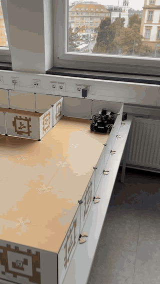
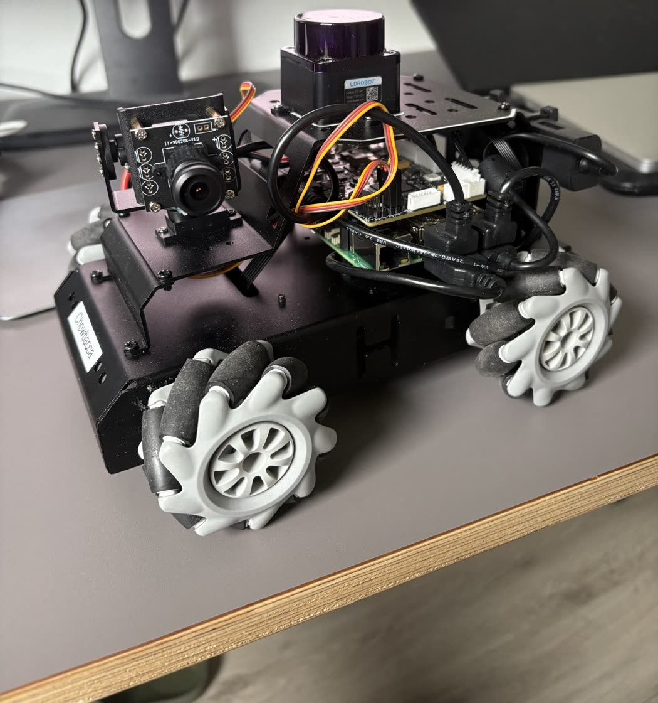
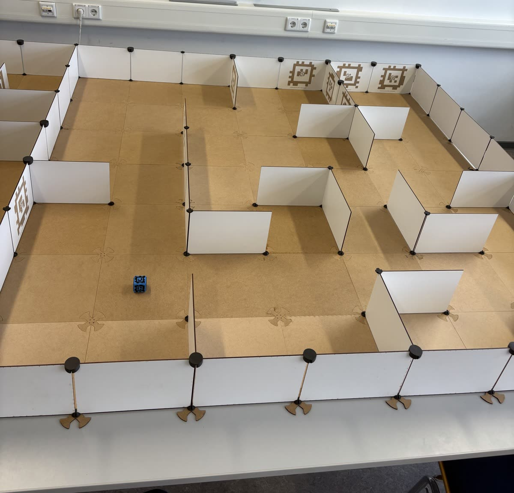
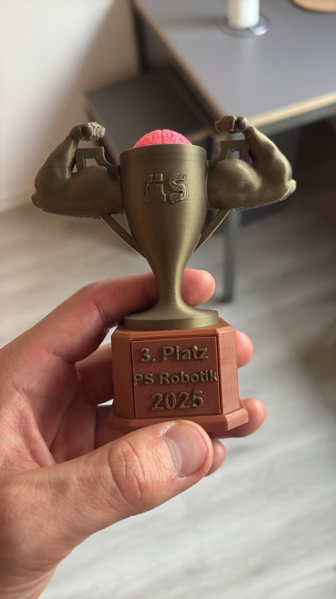

# Autonomous Maze Robot — ROS 2 · SLAM · Nav2

A small mecanum-wheel robot (Hiwonder MentorPi) that **solves a known maze, explores an unknown one, and finds a cube with AprilTags and determines its colour and position**, using a 2-D LiDAR, wheel odometry, an IMU and a camera. Built with ROS 2 Jazzy, slam_toolbox and Nav2 for the master's project seminar *Robotics and Computational Intelligence* at TU Darmstadt (summer term 2025), where the team placed **3rd** in the course competition.

**My part:**
- Configuration and tuning of **Nav2 and slam_toolbox** for the 0.254 m maze, with the Regulated Pure Pursuit controller
- **Goal sequencer** for task 1, which feeds the cell-centre goals to Nav2 (`task1_goal_sequencer`)
- **Hybrid explorer** for tasks 2 and 3, a cell walk plus frontier search (`task2_frontier_explorer`)

Teammates built the object detection and the map post-processing, see [Team](#team).

**Read more:** [System architecture](#system-architecture) · [Technical deep dive: Nav2, controller, SLAM, algorithms](docs/ARCHITECTURE.md) · [Tuned parameters vs. stock](docs/SOLUTION.md) · [Run notes](docs/RUNNING.md)

<p align="center">
  <br>
  <em>An early autonomous test run at 5x speed: the robot localises with SLAM and drives to its first goal with Nav2.<br>
  <a href="docs/media/demo.mp4">Higher-quality MP4</a></em>
</p>

| The robot: Hiwonder MentorPi with LiDAR and pan/tilt camera | The maze: 0.254 m cells with AprilTag walls | Result: 3rd place, PS Robotik 2025 |
|---|---|---|
|  |  |  |

## The three tasks

The maze is a grid of 0.254 m cells. All tasks run on **SLAM only**: the robot starts in a known cell, builds the map while driving, and never uses a pre-built map.

| Task | Problem | How it was solved |
|---|---|---|
| **1. Known maze** | The maze layout is given, drive from the start cell to the goal cell | A receiver node downloads the maze from a ROS service. The maze becomes a graph and Dijkstra is solved offline. A goal sequencer converts the cell path into SLAM-frame poses (cell centres) and feeds them to Nav2 one after another |
| **2. Unknown maze** | Nothing is known, map the whole maze | A hybrid explorer: it first walks cell by cell, preferring unvisited neighbours that the SLAM map shows as free. When it hits a dead end, it falls back to frontier search and drives to the nearest frontier centroid. Exploration ends when no new frontier centroid remains. The required output, a 2-D plot of the maze walls with the driven path, is rebuilt from the SLAM map afterwards |
| **3. Object search** | Find the object marked with an AprilTag and report its colour and position | Same exploration as task 2. A camera on a pan/tilt mount, set to a fixed angle, runs AprilTag detection in the background. On the first detection the explorer stops, the robot returns to the start, and the object's position and colour are stored |

Scoring in the competition: task 1 by time with penalties for wall collisions, task 2 by the correctness of the plotted maze, task 3 by search time and the correct cube position and colour. Each attempt was limited to 5 minutes, with two attempts per task.

Details: [docs/ARCHITECTURE.md](docs/ARCHITECTURE.md) explains the algorithms and the Nav2 / SLAM setup, [docs/SOLUTION.md](docs/SOLUTION.md) compares every tuned parameter with the stock value.

## System architecture

Two machines on one ROS 2 network (`ROS_DOMAIN_ID=3`, FastDDS):

```
 Robot (Jazzy, started at boot by systemd)                     Laptop (decision making)
 ┌───────────────────────────────────────────────┐            ┌───────────────────────────────────────┐
 │ ros_robot_controller + EKF  (wheel odom, IMU) │            │ Task 1: task1_maze_requester          │
 │ ldlidar_node               (LiDAR scan)        │  /map      │         task1_goal_sequencer          │
 │ slam_toolbox               (online async)  ────┼──────────► │ Task 2: task2_frontier_explorer       │
 │ Nav2: planner, RPP controller, BT navigator ◄──┼─────────── │         task2_map_reconstruction      │
 │ usb_cam + AprilTag + task3_object_detector     │  NavigateToPose goals                               │
 └───────────────────────────────────────────────┘            └───────────────────────────────────────┘
        /searchforce_status:  found → finish_detection → finished
```

The robot only runs the bring-up. The laptop runs the planning nodes and sends `NavigateToPose` goals to Nav2 on the robot, so algorithms could be changed without touching the robot.

## How it works

**Navigation stack.** slam_toolbox builds the map while the robot drives and publishes `map → odom`; there is no pre-built map and no AMCL. Nav2 plans on a costmap built only from that SLAM map: NavFn finds the global path, and a **Regulated Pure Pursuit** controller follows it. Pure Pursuit aims at a lookahead point on the path and steers along the arc through it, turning in place when the heading error is large and slowing near the end of a path. A custom behaviour tree replans at 1 Hz and clears the global costmap when a goal fails. The decision nodes run on a laptop and send `NavigateToPose` goals to Nav2 on the robot.

**What is specific to this maze.** Cells are only 0.254 m wide, so the stock tuning does not fit:

| Area | Tuned for the maze |
|---|---|
| Controller | 0.1 m/s, fixed 0.15 m lookahead, rotate-to-heading and reversing enabled, 0.15 m goal tolerance, final heading ignored |
| Costmaps | tiny footprint (about 2 cm), clearance via inflation (0.3 m radius, steep cost scaling 30), 1 × 1 m local window, 1 cm effective resolution |
| slam_toolbox | 1 cm map resolution, 1.3 m laser range, a new scan every 5 cm, 0.01 rad or 0.5 s |

**Task 1.** The maze (a grid of 4-bit wall masks) is downloaded over a ROS service and turned into a graph: moves between open neighbours cost 1, open diagonals cost √2. **Dijkstra** finds the shortest route because the edge weights differ. Each cell on the route becomes a goal at the cell centre, rotated into the SLAM frame, and a sequencer sends them to Nav2 one after another, advancing when the robot is within 0.4 m so it does not stop in every cell.

**Task 2 and 3.** A hybrid explorer walks cell by cell with a visit counter, always choosing the least-visited free neighbour, and switches to **frontier search** (free cells next to unknown cells, 8-connected clustering, nearest centroid) when it hits a dead end. Exploration ends when no frontier centroid remains. In task 3 an AprilTag detector runs on the robot and the first sighting stops the exploration.

## How to run

**Robot** (once, or via systemd, see [deploy/](deploy/)):
```bash
ros2 launch searchforce robot_bringup_launch.py
```

**Laptop** (same `ROS_DOMAIN_ID`), one task at a time:
```bash
# Task 1: known maze
ros2 run searchforce task1_maze_requester     # downloads the maze, writes rosfile.maze
ros2 run searchforce task1_goal_sequencer     # solves it offline and drives the path

# Task 2 and 3: unknown maze (the detector on the robot is part of the bring-up, so it also runs in task 2)
ros2 run searchforce task2_frontier_explorer
ros2 run searchforce task2_map_reconstruction # task 2: rebuilds the maze plot once status == finished
```

More in [docs/RUNNING.md](docs/RUNNING.md), including where each command comes from.

## Repository layout

```
ros2_ws/src/searchforce/
  searchforce/
    task1_maze_requester.py, task1_goal_sequencer.py, maze_solver.py
    task2_frontier_explorer.py, task2_map_reconstruction.py
    task3_object_detector.py
    functions/                 maze graph helpers (maze file loading, adjacency matrix, cell numbering)
  launch/                      robot_bringup_launch.py, navigation_launch.py (Nav2 with tuned params)
  config/                      Nav2 params, slam_toolbox params, replanning behaviour tree
deploy/                        systemd unit that starts the robot bring-up
docs/                          Solution write-up, run notes, media
```

## Build

Needs ROS 2 Jazzy, Nav2 and slam_toolbox (installed from apt, not copied into this repo), plus the robot software that the course provided. That starter workspace ([LinusGro/MentorPi_ris](https://github.com/LinusGro/MentorPi_ris), MIT licence) is not copied here either. The bring-up launch file includes these packages from it:

| Package | Role | Folder in the starter repo |
|---|---|---|
| `controller`, `ros_robot_controller`, `ros_robot_controller_msgs` | Motor and IMU driver, servo messages used by the detector | `ros2_ws/src/driver/` |
| `ldlidar_node` | LiDAR driver (Apache-2.0) | `ros2_ws/src/ldrobot-lidar-ros2/` |
| `peripherals` | Camera, image pipeline and AprilTag launch files | `ros2_ws/src/peripherals/` |
| `orchestrator_launch` | slam_toolbox launch file | `ros2_ws/src/orchestrator_launch/` |
| `maze_interface`, `maze_publisher_node` | Maze message, service and the maze server (Apache-2.0) | `ros2_ws/src/maze_interface/`, `ros2_ws/src/maze_publisher_node/` |

Nodes that import these packages (`task1_maze_requester`, `task3_object_detector`) and `robot_bringup_launch.py` only start on a workspace that contains them. Everything else, including the Nav2 and slam_toolbox configuration, builds and starts without them.

The Dockerfile builds the package on a plain `ros:jazzy` image, which checks that the package and its dependencies install and build without the vendor packages:

```bash
docker build -t autonomous-maze-explorer .
```

On a ROS 2 Jazzy machine:

```bash
sudo apt install python3-numpy python3-opencv python3-scipy python3-networkx python3-transforms3d \
  ros-jazzy-nav2-bringup ros-jazzy-slam-toolbox ros-jazzy-apriltag-msgs ros-jazzy-cv-bridge ros-jazzy-tf-transformations
pip3 install --break-system-packages numba   # not packaged for Ubuntu Noble
cd ros2_ws && colcon build --packages-select searchforce && source install/setup.bash
```

Each node writes its files to `~/searchforce_cache` on the machine it runs on: the maze file, robot track and reconstructed map on the laptop, the object result on the robot. Set `SEARCHFORCE_CACHE` to change it.

## Team

Group project in a team of four at TU Darmstadt. Everyone worked on the same ROS 2 package. This repo is a cleaned-up version of the code that ran in the competition, moved here from the team's GitLab.

**Moritz Hölper:** Nav2 and slam_toolbox tuning ([config/](ros2_ws/src/searchforce/config/), parameter table in [docs/SOLUTION.md](docs/SOLUTION.md)), `task1_goal_sequencer`, `task2_frontier_explorer`.

**Teammates:** the AprilTag object detection and colour classification (`task3_object_detector`), the post-processing of the SLAM map from task 2 (`task2_map_reconstruction`), and the project presentation.

## Credits

The course starter repo (robot drivers, maze service, maze file helpers) was provided by the course staff, see [THIRD_PARTY_NOTICES.md](THIRD_PARTY_NOTICES.md).

## Known limitations

- The robot drivers and the maze server come from the course starter repo and are not included, so the full bring-up does not run without them.
- No automated tests in the repo.
- Some comments and log messages are in German or Chinese. Earlier prototypes were removed.
- Tested in a plain ROS 2 Jazzy container with mocked vendor packages and a simulated map. The real robot, LiDAR, camera and timing were not re-tested after cleaning up the repo.
