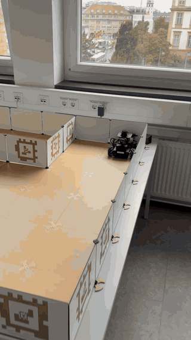
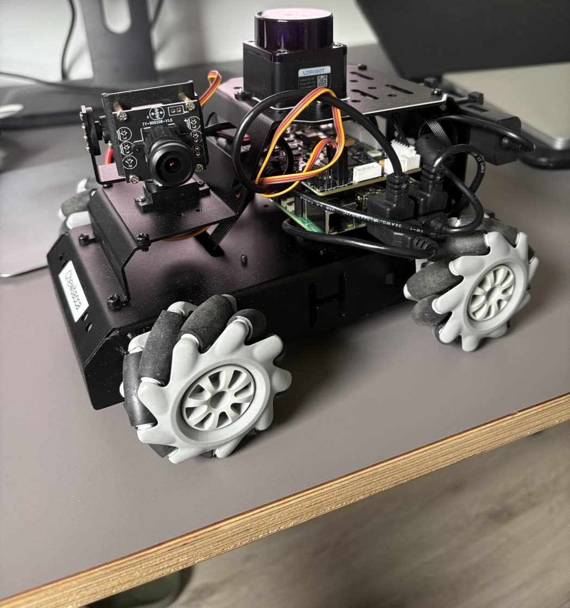
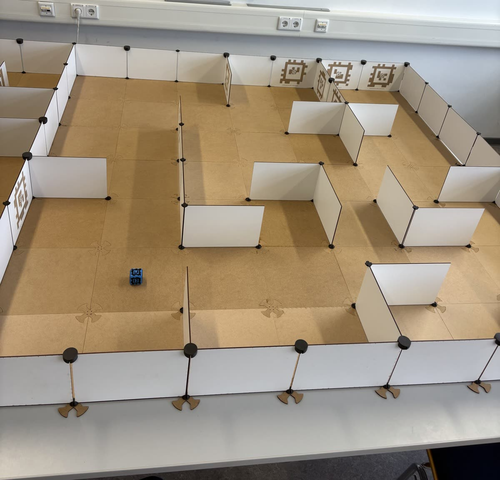
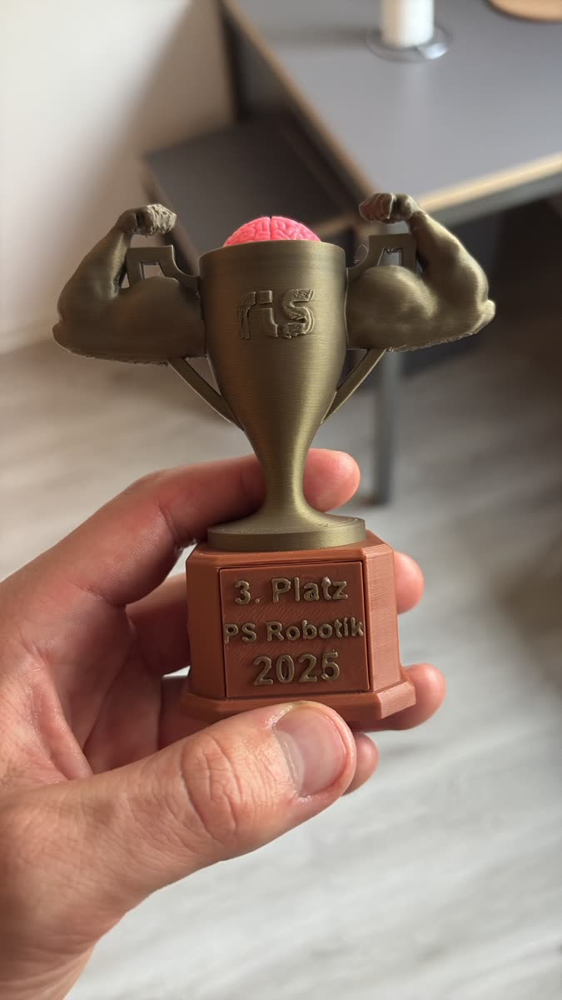

# Autonomous maze robot with ROS 2, SLAM, and Nav2

This repository has the code of a small robot with mecanum wheels, the Hiwonder MentorPi. The robot solves a known maze and explores an unknown one. It also finds a cube marked with AprilTags and reports the color and the position of the cube. It uses a 2-D LiDAR, wheel odometry, an IMU, and a camera. The software is ROS 2 Jazzy with slam_toolbox and Nav2.

We built the robot for the master's project seminar *Robotics and Computational Intelligence* at TU Darmstadt in the summer term 2025. Our team placed 3rd in the course competition.

I did three parts of the project:

- I configured and tuned Nav2 and slam_toolbox for the 0.254 m maze, with the Regulated Pure Pursuit controller.
- I wrote the goal sequencer for task 1, `task1_goal_sequencer`. It sends the cell-center goals to Nav2.
- I wrote the hybrid explorer for tasks 2 and 3, `task2_frontier_explorer`. It combines a cell walk with frontier search.

My teammates built the object detection and the map post-processing. [Team](#team) lists who did what.

The other documents cover these topics:

- [ARCHITECTURE.md](docs/ARCHITECTURE.md) explains the Nav2 and SLAM setup, the controller, and the algorithms for the three tasks.
- [PARAMETERS.md](docs/PARAMETERS.md) compares every tuned parameter with the stock value.
- [RUNNING.md](docs/RUNNING.md) shows how the nodes were started on the robot and on the laptop.

<p align="center">
  <br>
  <em>An early autonomous test run at 5x speed. The robot localizes with SLAM and drives to its first goal with Nav2.<br>
  <a href="docs/media/demo.mp4">The same run as an MP4 in higher quality</a></em>
</p>

| The robot: Hiwonder MentorPi with LiDAR and a pan-tilt camera | The maze: 0.254 m cells with AprilTag walls | The result: 3rd place, PS Robotik 2025 |
|---|---|---|
|  |  |  |

## The three tasks

The maze is a grid of 0.254 m cells. All three tasks use SLAM only. The robot starts in a known cell and builds the map while it drives. It never uses a map built before the run.

| Task | Problem | Solution |
|---|---|---|
| 1. Known maze | The maze layout is given. The robot drives from the start cell to the goal cell. | A node downloads the maze from a ROS service. The solver turns the maze into a graph and runs Dijkstra before the drive. The goal sequencer converts the cell path into cell-center poses in the SLAM frame and sends them to Nav2 one after another. |
| 2. Unknown maze | Nothing is known. The robot maps the whole maze. | The hybrid explorer first walks cell by cell and prefers unvisited neighbors that the SLAM map shows as free. At a dead end, it switches to frontier search and drives to the nearest frontier centroid. Exploration ends when no frontier centroid is left. A second node then draws the required 2-D plot of the maze walls and the driven path from the SLAM map. |
| 3. Object search | The robot finds the object with the AprilTag and reports its color and position. | The robot explores as in task 2. A camera at a fixed pan-tilt angle runs AprilTag detection in the background. On the first detection, the explorer stops, the robot returns to the start, and the detector stores the position and color of the object. |

The competition scored each task differently:

- Task 1 by time, with penalties for wall collisions.
- Task 2 by the correctness of the plotted maze.
- Task 3 by search time and by the correct position and color of the cube.

Each task allowed two attempts of 5 minutes each.

## System architecture

The robot and a laptop share one ROS 2 network, with `ROS_DOMAIN_ID=3` and FastDDS:

```
 Robot (Jazzy, started at boot by systemd)                              Laptop (decision making)
 ┌───────────────────────────────────────────────┐                      ┌──────────────────────────────────┐
 │ ros_robot_controller + EKF  (wheel odom, IMU) │                      │ Task 1: task1_maze_requester     │
 │ ldlidar_node               (LiDAR scan)       │  /map                │         task1_goal_sequencer     │
 │ slam_toolbox               (online async)     │ ───────────────────► │ Task 2: task2_frontier_explorer  │
 │ Nav2: planner, RPP controller, BT navigator   │ ◄─────────────────── │         task2_map_reconstruction │
 │ usb_cam + AprilTag + task3_object_detector    │ NavigateToPose goals │                                  │
 └───────────────────────────────────────────────┘                      └──────────────────────────────────┘
        /searchforce_status:  found → finish_detection → finished
```

The robot runs only the bring-up. The laptop runs the decision nodes and sends `NavigateToPose` goals to Nav2 on the robot. So we could change the algorithms without touching the robot.

## How it works

slam_toolbox builds the map while the robot drives and publishes the `map` to `odom` transform. There is no map from before the run and no AMCL. Nav2 plans on a costmap built only from the SLAM map. NavFn finds the global path, and a Regulated Pure Pursuit controller follows it. A custom behavior tree replans at 1 Hz and clears the global costmap when a goal fails.

The cells are only 0.254 m wide, so the stock Nav2 and slam_toolbox tuning does not fit. The robot drives at 0.1 m/s with a fixed lookahead of 0.15 m. The SLAM map and the costmaps have a resolution of 1 cm. A tiny footprint and a steep inflation curve keep the paths near the corridor center. [PARAMETERS.md](docs/PARAMETERS.md) lists every changed value.

In task 1, Dijkstra finds the shortest route on the maze graph. A move to a neighbor costs 1, and an open diagonal costs √2. Breadth-first search would be wrong, because the costs differ. The sequencer sends the next cell center when the robot is within 0.4 m of the current one, so the robot does not stop in every cell.

In tasks 2 and 3, the explorer walks cell by cell and always picks the least-visited free neighbor. At a dead end, it switches to frontier search. A frontier is a free map cell next to an unknown map cell. In task 3, an AprilTag detector runs on the robot, and the first detection stops the exploration.

## Run the nodes

On the robot, start the bring-up. The systemd unit in [deploy/](deploy/) can start it at boot instead.

```bash
ros2 launch searchforce robot_bringup_launch.py
```

On the laptop, set the same `ROS_DOMAIN_ID` and run one task at a time. For task 1, download the maze and drive the path:

```bash
ros2 run searchforce task1_maze_requester
ros2 run searchforce task1_goal_sequencer
```

For tasks 2 and 3, start the explorer:

```bash
ros2 run searchforce task2_frontier_explorer
```

For task 2, also start the map reconstruction. It draws the maze plot when the status is `finished`.

```bash
ros2 run searchforce task2_map_reconstruction
```

The object detector is part of the robot bring-up, so it also runs during task 2. [RUNNING.md](docs/RUNNING.md) has the environment variables and the tools we used during the project.

## Repository layout

```
ros2_ws/src/searchforce/
  searchforce/
    task1_maze_requester.py, task1_goal_sequencer.py, maze_solver.py
    task2_frontier_explorer.py, task2_map_reconstruction.py
    task3_object_detector.py
    functions/                 maze graph helpers: maze file loading, adjacency matrix, cell numbering
  launch/                      robot_bringup_launch.py, navigation_launch.py (Nav2 with the tuned parameters)
  config/                      Nav2 parameters, slam_toolbox parameters, replanning behavior tree
deploy/                        systemd unit that starts the robot bring-up
docs/                          architecture, parameters, run notes, media
```

## Build

You need ROS 2 Jazzy, Nav2, and slam_toolbox from apt. You also need the robot software from the course starter workspace, [LinusGro/MentorPi_ris](https://github.com/LinusGro/MentorPi_ris), under the MIT license. This repository does not include any of them. The bring-up launch file includes these packages from the starter workspace:

| Package | Role | Folder in the starter workspace |
|---|---|---|
| `controller`, `ros_robot_controller`, `ros_robot_controller_msgs` | Motor and IMU driver, and the servo messages that the detector uses. | `ros2_ws/src/driver/` |
| `ldlidar_node` | LiDAR driver, under Apache-2.0. | `ros2_ws/src/ldrobot-lidar-ros2/` |
| `peripherals` | Launch files for the camera, the image pipeline, and AprilTag. | `ros2_ws/src/peripherals/` |
| `orchestrator_launch` | The slam_toolbox launch file. | `ros2_ws/src/orchestrator_launch/` |
| `maze_interface`, `maze_publisher_node` | The maze message, the maze service, and the maze server, under Apache-2.0. | `ros2_ws/src/maze_interface/`, `ros2_ws/src/maze_publisher_node/` |

`task1_maze_requester`, `task3_object_detector`, and `robot_bringup_launch.py` start only in a workspace that contains these packages. Everything else builds and starts without them, including the Nav2 and slam_toolbox configuration.

The Dockerfile builds the package on a plain `ros:jazzy` image. The build checks that the package and its dependencies install and build without the vendor packages.

```bash
docker build -t autonomous-maze-explorer .
```

To build on a ROS 2 Jazzy machine, install the dependencies first:

```bash
sudo apt install python3-numpy python3-opencv python3-scipy python3-networkx python3-transforms3d \
	ros-jazzy-nav2-bringup ros-jazzy-slam-toolbox ros-jazzy-apriltag-msgs ros-jazzy-cv-bridge ros-jazzy-tf-transformations
```

Ubuntu Noble has no package for numba, so install it with pip:

```bash
pip3 install --break-system-packages numba
```

Then build the package:

```bash
cd ros2_ws && colcon build --packages-select searchforce && source install/setup.bash
```

Each node writes its files to `~/searchforce_cache` on the machine it runs on. On the laptop, that is the maze file, the robot track, and the reconstructed map. On the robot, it is the object result. To use a different folder, set `SEARCHFORCE_CACHE`.

## Team

We were a team of four at TU Darmstadt and all worked on the same ROS 2 package. This repository is a cleaned-up copy of the code that ran in the competition, moved here from the GitLab of the team. The code is the work of the team from 2025. I prepared the cleanup and the documentation of this public version with an AI assistant (Claude).

I, Moritz Hoelper, did the Nav2 and slam_toolbox tuning in [config/](ros2_ws/src/searchforce/config/), with the parameter table in [PARAMETERS.md](docs/PARAMETERS.md). I also wrote `task1_goal_sequencer` and `task2_frontier_explorer`.

My teammates wrote the AprilTag object detection and color classification in `task3_object_detector`, and the post-processing of the SLAM map from task 2 in `task2_map_reconstruction`. They also made the project presentation.

## Credits

The course staff provided the starter workspace with the robot drivers, the maze service, and the maze file helpers. [THIRD_PARTY_NOTICES.md](THIRD_PARTY_NOTICES.md) has the license text.

## What I would do differently

The code grew by trial and error on the robot over one semester, and you can see it. The explorer is long and repetitive, there are no tests, and some log messages are in German. I left the code as it ran in the competition and did not polish it afterwards. Today I would change five things:

- **Plan on the map, not on an assumed grid.** The cell walk puts goals on an absolute grid and assumes that the SLAM map is aligned with the maze. Small rotations of the map moved those goals away from the real cells, and we added frontier search to work around that. It would have been simpler to start with frontier search, or to align the map with the maze first.
- **Pick frontiers by path length.** The explorer uses straight-line distance, so it can pick a frontier that is close but behind a wall.
- **Read the math behind a parameter before I tune it.** We tuned mostly by trial and error and judged each change by one run, and one run can be chance. One look at the formula would have shown the problem with `minimum_angle_penalty: 5.0`. We raised the value to get a stronger heading penalty. In the scan matcher, the value is the floor of a `max()` around a multiplier that is at most 1. Any value above 1 therefore turns the penalty off. [ARCHITECTURE.md](docs/ARCHITECTURE.md#slam-with-slam_toolbox) has the details. Today I would read the source or the method behind a parameter first, change one parameter at a time, and compare several runs on the same route.
- **Write the grid and frontier helpers as pure functions with unit tests.** Then I could check them without the robot.
- **Record the test and competition runs**, with videos, rosbags, and the maze plots from task 2. The only footage left is one early test run. Nothing is left from the competition day.

## Known limitations

- The robot drivers and the maze server come from the course starter workspace and are not in this repository. Without them, the full bring-up does not run.
- The repository has no automated tests.
- Some comments and log messages are in German or Chinese.
- After the cleanup, I tested the code in a plain ROS 2 Jazzy container with mocked vendor packages and a simulated map. I did not test it again on the real robot, LiDAR, and camera.
